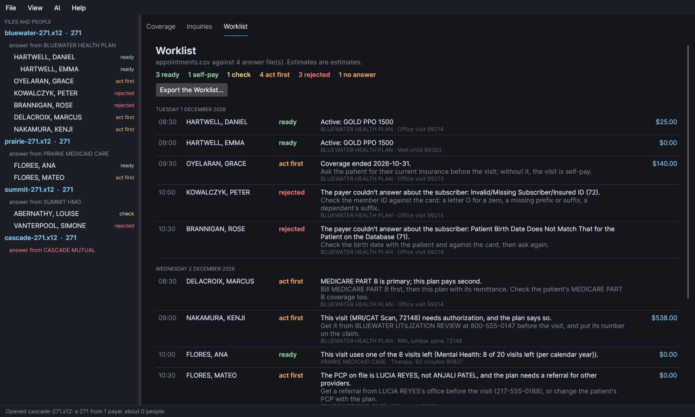
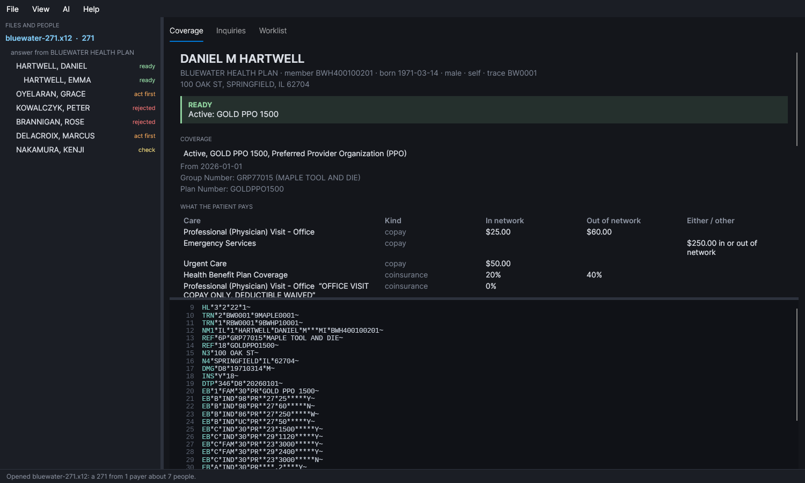
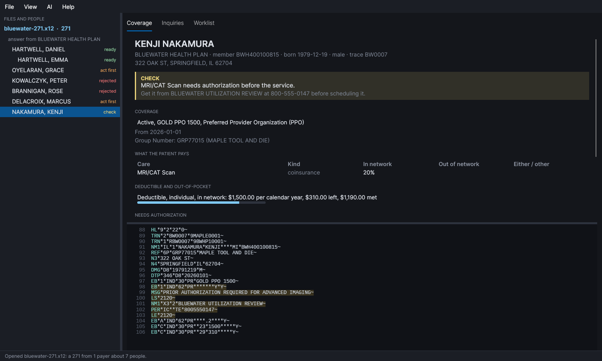
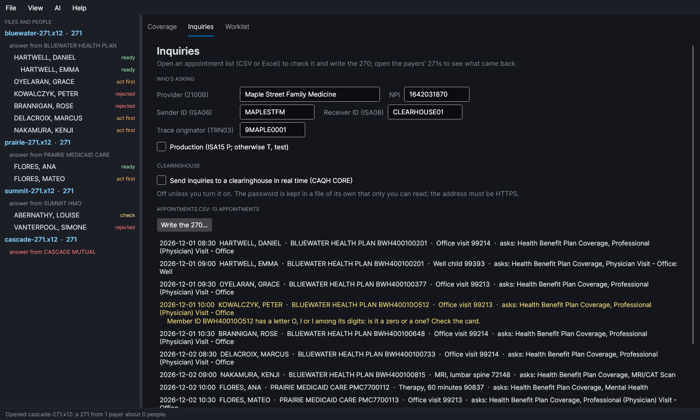
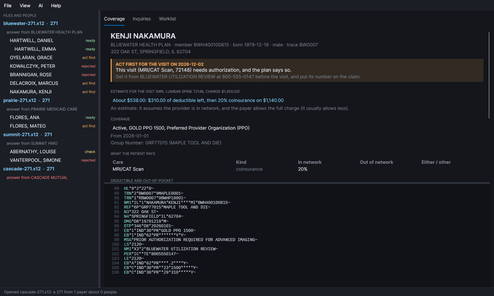
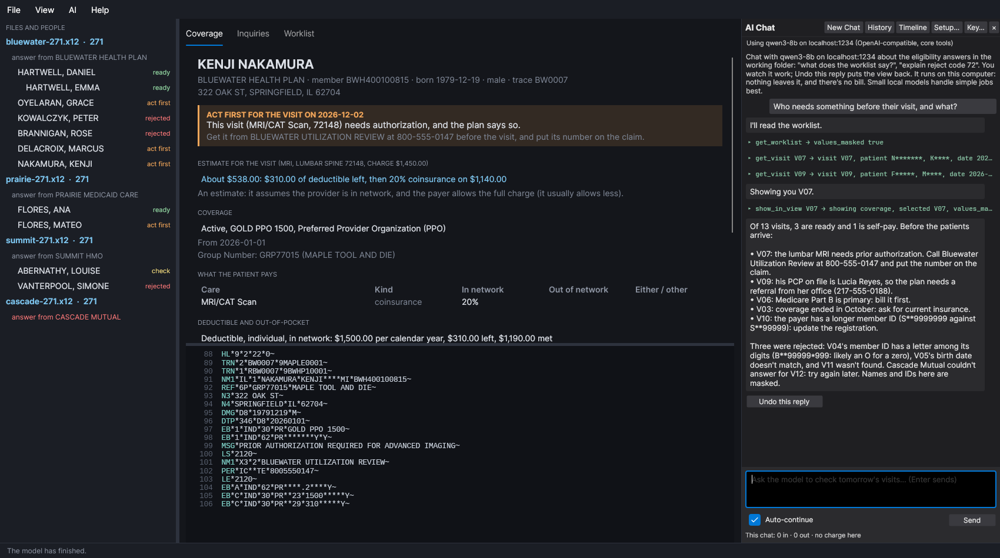
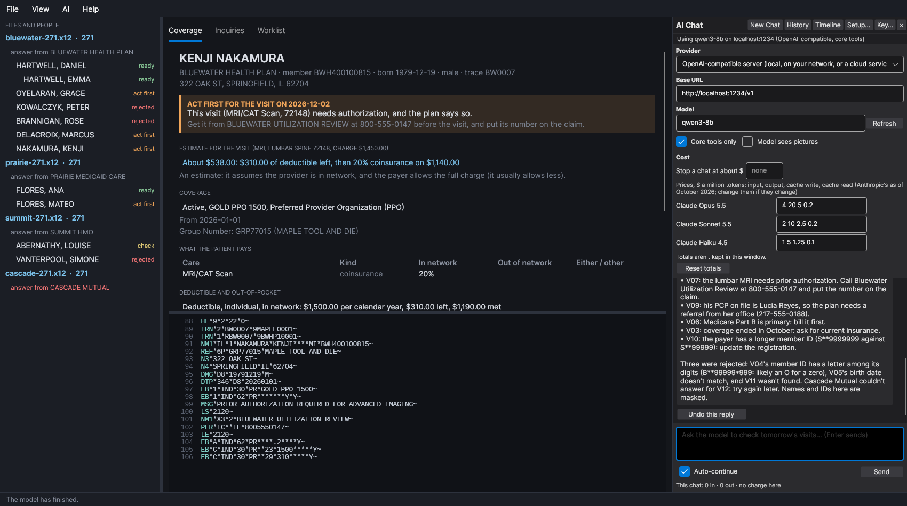

# AVA Eligibility

Know who's covered before they arrive. AVA Eligibility reads HIPAA **270** eligibility inquiries and the payers' **271**
answers (005010X279A1) and says what they mean in plain words. For each patient it shows whether they're active, the
copay, how much deductible is left, what needs authorization, who the primary care provider is, and whether another
payer comes first. For each visit on the schedule it gives a verdict:

- **ready**;
- **check**: something to look at;
- **act first**: something to do before the visit, and exactly what;
- **rejected**: the payer couldn't match the inquiry, and what to fix;
- **no answer**.

It also estimates what the patient may owe.

It starts from the clinic's **appointment list**. It checks each row before anything is sent (a letter O among a
member ID's digits is caught before the payer rejects it), writes the **270**, and matches each **271** back to its
question. It can also ask a clearinghouse in real time over **CAQH CORE** connectivity, off until you set it up.

It has an **AI Chat** (F12) and an **MCP server**, so Claude or a model on your own computer can go through the day's
schedule, explain a rejection, or work out what a patient owes. **Agents see people's details masked** unless you say
otherwise. See [AI: the chat and agents](#ai-the-chat-and-agents).



## Download

Builds for Windows, macOS and Linux (Intel/AMD and ARM) are on the
[releases page](https://github.com/Harlock123/AVAEligibility/releases). Unzip or untar and run `AVAEligibility`
(`AVAEligibility.exe` on Windows); nothing else needs installing.

## Reading an answer

Open 271s (File › Open, or drop them on the window) and choose a person. The **Coverage** tab reads their answer
verdict first. Under the verdict are the notes behind it, each with what to do. Then the benefits are grouped the way
a front desk reads them:

- what the patient pays (copays and coinsurance, in network and out);
- deductibles and out-of-pocket maximums, with what's left;
- limits ("8 of 20 visits left");
- what needs authorization, and whom to call;
- the PCP, and other payers and who's primary;
- what isn't covered, and the payer's own words.

At the bottom is every line the payer sent. Clicking a line highlights the segments it came from.



Rejections (AAA) are explained, with what to check: the card, the birth date, the payer. Every code is read from the
005010X279A1 lists. The service types were checked against the table in CAQH CORE's Eligibility & Benefits Data
Content Rule. A code a list hasn't got is shown as such, never guessed.



## The appointment list and the 270

Open the appointment list, a CSV or Excel file. Columns are found by name (Date, Last name, Birth date, Payer ID,
Member ID, Subscriber, Provider NPI, Procedure, Charge…). **Inquiries** shows every visit, with what the 270 will ask
about. It always asks about plan coverage (30), plus the kind of care the procedure is: an office visit, a well visit,
mental health, MRI or CT, and so on. It also shows each row's checks:

- **errors** (the row isn't sent): no payer, no name, a birth date after the visit, a character that would break the
  file;
- **warnings**: a letter O, I or l among a member ID's digits, no birth date, a dependent whose subscriber isn't listed.

**File › Write the 270** writes one transaction per payer, with each dependent under their subscriber and a trace
number on every question. Each 271 is matched back to its question by that trace, or by payer, member ID and name.



## The worklist

With the list and the 271s open, **Worklist** reads every visit's answer for that visit's date and care. On top of what
the answer says, it checks what only the visit can tell:

- the visit's care needs authorization or isn't covered;
- it uses one of a limited number of visits;
- it's with someone other than the PCP the plan has on file (a referral);
- the payer has the patient's member ID, name or birth date differently from registration, so the claim would be
  rejected.

The **estimate** uses the visit's copay, or what's left of the deductible and then the coinsurance, up to what's left
of the out-of-pocket maximum. It always says what it rests on and what it assumes (in network, the full charge
allowed): it's an estimate, and the payer decides. When two answers about the same person are open, the Coverage tab
says what changed since the earlier one: the deductible used since, a payer that no longer shows as primary, coverage
that started or ended.



**View › Export the Worklist** writes it as an HTML page or an Excel workbook.

The 271s it saves feed claims too: [AVA Claim Scrubber](https://github.com/Harlock123/AVAClaimScrubber) (1.1 and later)
checks each claim against the payer's 271 about its patient before it's sent (coverage on the dates, the member found,
another payer primary, a missing authorization), and its denial replay catches eligibility denials with them.

## Asking a clearinghouse

**Inquiries › Clearinghouse** sends each appointment's question in real time, through the clearinghouse you set up,
over CAQH CORE connectivity. You choose the envelope: HTTP MIME multipart, or SOAP with WS-Security. Each answer is
saved as a 271 beside the appointment list and opened, so the worklist fills in.

- Sending is off until you turn it on.
- The address must be HTTPS.
- **Ask Now** asks you first, saying how many questions are going and where.
- The password is kept in a file of its own that only you can read.
- The tests only ever talk to a mock clearinghouse on the test machine itself.

## AI: the chat and agents

**AI › AI Chat** (F12) opens a chat on the right. It works with Claude (an Anthropic API key) or with a model on your
own computer or network: Ollama, LM Studio, any OpenAI-compatible server, or a local server that speaks Anthropic's
Messages API. It can use every tool, or a core set for small models. Undo this reply puts the view back.



**Agents see people's details masked.** Every name, member ID, identifier and address in the open files and the
appointment list is masked to its shape wherever it turns up, whether in a note, a payer's message or a raw segment.
`BWH40010O512` becomes `B**99999*999`, so a letter among the digits still shows, and a longer ID shows as longer.
Addresses are hidden, and every date keeps only its year. Agents refer to people by handle: P01… for people in the
files, V01… for visits.

Payers, providers, codes and amounts aren't people's details and are shown. **AI › Let AI Agents See Values** turns
masking off; use it only with a model your organisation may send PHI to. Starting with `--mask` keeps masking on
whatever the setting says. Writing a 270 needs values allowed. Asking the clearinghouse runs only in the open window,
after your yes.

Outside agents (Claude Code, Claude Desktop, any MCP client) connect in three ways:

```bash
# Attached to the open window (AI › Allow AI Agents must be on): the agent works on what's open there.
claude mcp add avaeligibility -- /path/to/AVAEligibility --mcp --attach

# Headless, on a folder of 271s and appointment lists.
claude mcp add avaeligibility -- /path/to/AVAEligibility --mcp --root /path/to/files

# Over the network, with a token (AI › Connect an Agent in the window, or headless):
AVAEligibility --mcp --http 8779 --root /path/to/files [--token TOKEN] [--cert CERT --key KEY]
```



| Tool | What it does |
|---|---|
| `list_files`, `open_file`, `close_file`, `list_open` | 270s, 271s and appointment lists in the working folder; open and close them |
| `list_people`, `get_answer`, `get_benefits`, `get_segments` | Everyone in the files with their verdict; a person's answer made sense of; every line in words; the raw segments |
| `explain_code`, `search_codes` | Any 270/271 code's meaning (and what to do about a rejection); codes by words |
| `get_appointments`, `check_appointments`, `service_types_for` | The visits and what each asks about; the checks before sending; what a procedure asks about |
| `write_inquiry` | Writes the 270 (values allowed only) |
| `get_worklist`, `get_visit`, `estimate`, `compare_answers` | The day's verdicts; a visit in full; what-if estimates; what changed since an earlier answer |
| `export_worklist` | The worklist report, `.html` or `.xlsx` (masked unless allowed) |
| `ask_clearinghouse` | Sends the day's questions in real time (the open window only, after the person's yes) |
| `get_view`, `show_in_view`, `render_view` | What the window shows; select a person or visit there; a picture of an answer or visit |
| `batch`, `get_recording`, `save_steps`, `run_steps` | Several calls at once; keep a session's calls and run them again |
| `checkpoint`, `diff`, `render_checkpoint`, `restore_checkpoint` | Remember what's open and the view, see what changed, go back |

Recipes (MCP prompts): check the day's schedule, explain a rejected inquiry, a visit's next step, what the patient may
owe, what changed since the last check, fix the list and ask again, find other payers, and the day's report. Each is
run call by call in the tests.

## Command line

```bash
AVAEligibility [files or folders…] [--real | --mask]   # open 270s, 271s and appointment lists; what agents see
AVAEligibility --mcp [--attach] [--root FOLDER] [--real | --mask] [--http [ADDRESS:]PORT …]
```

## Samples

`samples/` holds an invented family clinic, made by `make_samples.py`:
- `appointments.csv`, thirteen visits over three days;
- `clinic-270.x12`, exactly what the app writes from that list;
- the 271s its four payers sent back: a PPO, Medicaid managed care, an HMO, and one whose system was down;
- `recheck/`, the PPO's answer when asked again two weeks later.

Each patient has one situation planted: full benefits, a dependent, coverage ended, a member ID with a letter O, a
birth date that doesn't match, Medicare primary, an MRI needing authorization, a visit limit, a PCP elsewhere, a member
ID suffix, not found, the payer down, and self-pay. Every person, payer, member ID and NPI is made up.

## What it isn't

It isn't a clearinghouse or a practice-management system. It reads only 005010X279A1. It doesn't do 276/277 claim
status or 278 authorization requests; it says when an authorization is needed and whom to call. A 271 isn't a promise
of payment, and the estimates are estimates. Payers' companion guides can differ on service types and how they answer.

## Building

```bash
dotnet build AVAEligibility.slnx
dotnet test AVAEligibility.slnx
ELIG_SHOTS=Screenshots dotnet test --filter Screenshots          # these pictures
cd samples && python3 make_samples.py                            # the samples
```

.NET 10 and Avalonia 11.3. `AGENTS.md` has how the code is put together.

## License

MIT
